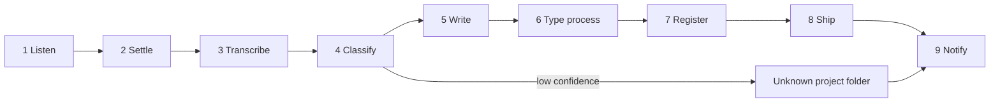

# voice-to-repo-architecture

## purpose

This document describes how voice-memo-export (package `vmea`) grows from an exporter of Voice Memos into a pipeline that turns each memo into shipped repository work. An always on Mac records nothing itself. It watches the Voice Memos library, transcribes each new recording, decides which project and which document type the memo belongs to, writes the document, and carries it through a commit, a pull request, a merge and cleanup, with no manual step.

The pipeline must run as a standalone tool on any machine and for any set of projects, so nothing in it assumes one person's paths or repositories. This document is the design that every later increment is built against. It contains no code and changes no behaviour. Each increment after it is its own pull request.

## decisions-in-force

Four decisions are made and are recorded in [the decision record](../adr/2026-10-14-voice-memo-to-repository-pipeline.md), which has status PROPOSED until it is accepted.

- Merging: a pull request auto-merges when its gates are green, and this includes code, not only documents.
- Approval by voice: saying "approved" in a memo sets the target ADR to accepted, with the memo id and the quoted words stored as evidence.
- Where it lives: the orchestrator lives in this repository.
- Unknown project: a memo that cannot be matched to a project goes to a folder the user chooses during setup.

## pipeline

Nine stages run in order. Each stage is a module with its own interface, so a later increment can replace or test one stage on its own.

The memo's id, held as a `MemoState` in `state.py`, makes each stage safe to run twice. A memo that fails a stage goes to a dead letter folder with the error attached, and the existing `vmea retry-failed` command is extended to pick it up again.

### stage-1-listen

A launchd agent fires on file changes in the configured source folder. There is no polling. The existing watchdog loop in `watch()` in `cli.py` stays as the fallback for machines where the launchd watch is not installed.

### stage-2-settle

A recording that is still being written or still syncing must not be read. The stage reuses `discovery.check_file_stability`, which samples the file several times at an interval, and adds a check for iCloud placeholder files, which exist on disk but hold no audio yet.

### stage-3-transcribe

The iOS transcript is used first, read through `parser.extract_tsrp_atom` and `parser.extract_transcript_from_plist`. When there is none, a pluggable transcription engine runs, with whisper.cpp or mlx-whisper on the Mac's GPU as the default. The transcript is then scanned for credential shaped values before anything is stored or committed.

### stage-4-classify

The classifier works out three things: the project, the document type, and any approval cue. A spoken cue wins over the model's guess. If confidence falls below the configured threshold, the memo goes to the unknown project folder and the user gets a notification.

### stage-5-write

The stage writes `<repo>/<memo_dir>/<name>.md` in the target repository, with frontmatter and links. It reuses `writer.generate_note_content`. The naming rule and the links are described in the next section. The stage replaces `writer.generate_filename` and `writer.get_next_sequence_number`, which use the older `YYYY-MM-DD-XX-title` pattern.

### stage-6-type-process

Each project carries its own profile: templates, the ADR numbering style, the work item generator command and the regenerate command. This stage applies the profile for the document type the classifier chose, such as an ADR, a work item, an idea, a bug or a plain note.

### stage-7-register

The stage runs the registry or graph update command that the project profile names, so the new document is visible to whatever indexes the repository.

### stage-8-ship

The stage runs these steps in order.

- Create a worktree and a branch, and commit under the configured author.
- Push the branch and open the pull request.
- Run the project's gates, and auto-merge only when they pass.
- Remove the branch and the worktree.
- Post the handoff comment on the pull request.

### stage-9-notify

The stage sends the pull request link, or the failure reason, to a configured channel: a macOS notification, ntfy or a webhook.

## naming-and-links

Every note is named `yyyy-MM-dd-HH-mm-{project}-{summary}`, for example `2026-10-14-16-12-agent-graph-split-style-profile-from-default-rules.md`.

- The date and time are when the memo was recorded, in local time. They come from `parser.parse_date_from_filename` or the memo's metadata, never from when it was processed.
- `{project}` is the project's registry slug, or the unknown folder slug set during setup.
- `{summary}` is no more than seven words in lowercase kebab-case. The summary model produces it and code trims it to enforce the limit. It is checked against the client name list.
- If two memos land in the same minute with the same name, the second gets `-2`.

The rename applies to everything vmea creates: the note, any copy of the audio, and the title shown in Speakr. The original recording in the Voice Memos library is never renamed or moved, because the Voice Memos app owns it and iCloud would sync the change back to the phone. The memo id stays only in the `state.py` ledger, which keeps processing safe to repeat.

The note frontmatter carries two links.

- `voice-memo` opens the recording in the Voice Memos app. Voice Memos has no URL scheme of its own, so this reuses the Shortcuts deep link built in `writer.py`, `shortcuts://run-shortcut?name=VMEA%20Open&input=text&text=<encoded path>`. Setup installs or checks the `VMEA Open` shortcut, replacing the manual steps in `cli.setup_vmea_shortcut`.
- `audio-file` is a `file://` link to the audio. It points at the copy when one was made, otherwise at the original in the library.

Tests check that both links are present and correctly encoded, including paths with spaces.

## audio-folder-auto-discovery

Finding the audio folder is the hardest step for a non technical user. Today `discovery.find_source_path` walks the entries in `VOICE_MEMOS_PATHS` and returns the first one that exists. `discovery.diagnose_paths` counts the `.m4a` files in each, but only `vmea doctor` shows that count. The design replaces both with a probe that runs in six layers and explains what it found.

1. Check the known paths. Keep `VOICE_MEMOS_PATHS`. For each path record one of four states instead of a plain yes or no: missing, present and readable, present but blocked by Full Disk Access (listing it raises a permission error), or present but empty. Today a path that exists but is blocked counts as found, and the failure only shows up later.
2. Search wider. If no known path works, run a Spotlight query with `mdfind` for Voice Memos audio and for the `CloudRecordings.db` database. Rank the folders it finds by how many memos they hold and how recent the newest one is. This covers a macOS version that moves the folder.
3. Pick and confirm in plain words. Choose the readable folder with the most memos and show something like "Found 312 recordings, newest from yesterday 4:12 pm. Use this?" Ask only when two or more folders are plausible.
4. Fix permissions with the user. If a folder is blocked, open the Full Disk Access pane of System Settings with `open x-apple.systempreferences:com.apple.preference.security?Privacy_AllFiles`. Name the exact app or interpreter to add, wait while they do it, and check again. Never ask them to type a path.
5. Check sync. If there are no recent memos, explain how to turn on Voice Memos in iCloud on the phone and the Mac, then offer a live test: record a 3 second memo now, and time how long it takes to arrive.
6. Fall back to a folder the user chooses. If they will not grant Full Disk Access, offer a plain folder instead. They share memos into it from the Voice Memos app and the watcher reads that folder. `cli.choose_folder` already provides the picker.

Each layer is a pure function with fixture tests, including a fake blocked directory, so the probe is tested on Linux CI as well as on the Mac. That a blocked folder really raises a permission error, rather than looking empty, needs a check on a real Mac in increment 2.

## setup-wizard

`vmea init` becomes a wizard. For each step it checks the item and offers a fix, and it can be run again safely.

1. Source folder: found by the automatic probe above, including the Full Disk Access fix and the live sync test, with an override available.
2. Full Disk Access for the interpreter that launchd runs. This is checked separately from step 1, because the background agent is a different process from the terminal.
3. The unknown project folder. It is required and has no default.
4. The projects: add each repository path, its aliases and its profile.
5. The transcription engine.
6. The LLM used for classification.
7. The notification channel.
8. The merge policy.
9. Speakr, which is optional.
10. Keeping the Mac awake: show the `pmset -c sleep 0` guidance and test it.
11. A dry run against one memo.

## custom-instructions

Instructions are layered, and a later layer adds to or overrides an earlier one.

1. Global: `cleanup_instructions_path` in config today, loaded by `cleanup.py`.
2. Per project, in the project profile.
3. Per document type: ADR, work item, idea, bug, note.
4. Spoken in the memo itself, such as "for this one, keep it to three bullets", pulled out by the classifier.

Each layer can set the transcription hint (vocabulary and names that bias Whisper), the cleanup prompt, the title prompt, the summary prompt and the template the type uses.

`vmea instructions show <project> <type>` prints the merged result, so it is never a guess which prompt ran.

### speakr-tag-sync

Speakr already has the same idea: tags and folders each carry a summary prompt (`custom_prompt`), a title prompt (`title_prompt`) and a transcription hint (`default_initial_prompt`), and tags stack. Speakr cannot be the only home for these instructions, for two reasons. Routing, typing and the git steps happen in vmea, before and outside Speakr. And Speakr is optional, while the tool has to work without it.

So vmea keeps the layered instructions as the original. When the Speakr connector is on, vmea creates or updates one Speakr tag for each project and each type through `POST /api/v1/tags` and `PUT /api/v1/tags/<id>`, copying the same prompts, and attaches those tags on upload. Summaries in Speakr then match the repository's, and instructions are edited in one place.

## speakr-connector

Speakr is an optional connector, so the tool stays standalone without it. Speakr is licensed under the AGPL, and its watched folder deletes source files, so vmea never points that folder at the Voice Memos library.

- `vmea speakr up` runs `docker compose up` and opens the browser and a log terminal whenever the user asks.
- Each memo is uploaded through `POST /api/v1/recordings/upload` with a title, `meeting_date`, the iOS transcript as `notes`, `tag_ids` taken from the project, and the memo id sent both as an entry in `external_refs` and as the `idempotency_key`.
- The phone notification carries the link to that recording in Speakr.
- The config flag `speakr.open_on_ingest` gives the literal open on every memo behaviour to anyone who wants it. It is off by default, because opening a terminal and a browser for every memo on an unattended Mac only piles up windows.

Speakr re-transcribes on CPU inside Docker, so its transcript is a second copy and not the main one.

## machine-agnostic-design

The tool must run on any Mac for any set of projects.

- No hardcoded user paths.
- One config file at `~/.config/vmea/config.toml`, with a schema version and a migration that extends `config.migrate_legacy_config`.
- A project registry in the config: name, path, aliases and profile. A personal registry elsewhere is one possible way to fill it, and nothing depends on it.
- The agent runner is pluggable: `claude -p` by default, and any command template otherwise.
- The git host is reached through `gh`, and the author identity is set in config.

## risks

- Auto merging code on green means the gates are the only check. The design requires each project profile to declare its gates, and refuses auto merge for any project that does not.
- Whether Voice Memos sync with the Voice Memos app closed on the Mac, and how fast memos arrive, are both unverified. Increment 2 tests them first.
- Approval by voice is recorded with the memo as its evidence, so a wrong approval can be traced to its recording.
- Transcripts may contain sensitive text, so the redaction scan runs before any commit.
- Audio never goes into git.

## delivery-increments

Increment 1 is this design, delivered as three documents in one docs only pull request: a release readiness review, this architecture document, and the decision record. It produces no code.

Each increment after it is its own pull request with a dry run mode, and none starts before the previous one merges.

1. Make the foundation green: the Python 3.11 crash, ruff and mypy, the missing `vmea shortcut-setup` command, the README, and launchd `bootstrap` with escaped values in place of the deprecated `launchctl load` used by `cli.daemon_install`.
2. Capture daemon: the automatic folder probe with the Full Disk Access fix flow, built first because it is the hardest step for non technical users; the setup wizard, including the unknown folder; config schema v2; a launchd watch on the source folder; settle and placeholder handling; a pluggable transcription engine; and tests for the sync timing.
3. Router: the project registry, the classifier, the unknown folder and notifications.
4. Writer and type processes: the `yyyy-MM-dd-HH-mm-{project}-{summary}` naming with tests for the seven word limit, collisions and time zones; project profiles, templates, the approval cue, and the layered custom instructions with `vmea instructions show`.
5. Ship: worktree, pull request, gates, auto merge, cleanup and handoff.
6. Register and plan: the graph and registry update, and work items through the project's own commands.
7. Speakr connector: `vmea speakr up`, the upload, the deep link, and copying each project's and type's instructions into Speakr tags.
